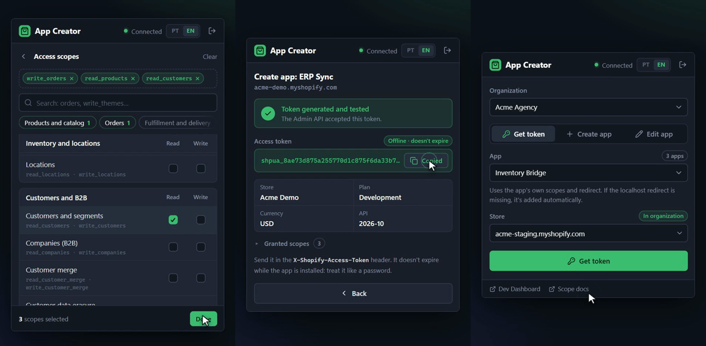

# Extension-Shopify-Apps

**Shopify App Creator** is a Chrome extension that creates Shopify apps and gets their Admin API access token without copy-pasting client IDs, callback URLs or client secrets. It talks to Shopify the same way the [Shopify CLI](https://shopify.dev/docs/api/shopify-cli/app) does.

*Screenshots use fictional data.*

[Português abaixo](#português)

## What it does

- **Get token**: pick an existing app and a store and get its offline Admin API token. The extension fetches the client secret, runs the OAuth install, catches the callback and tests the token on the Admin API. If the app has no redirect URL the extension can capture, it adds `http://localhost/` to the app first.
- **Create app**: name, scopes and store. The extension creates the app, releases a version with the scopes, installs it and returns the token.
- **Edit app**: change name, app URL, scopes and redirect URLs of an existing app, then release a new version (like `shopify app deploy`).
- **Scope presets**: one-click combos for common apps (ERP, catalog/PIM, inventory, logistics/WMS, CRM, reports/BI, theme & content, headless). Presets skip scopes that need Shopify approval.
- **English and Portuguese** UI, switchable in the header.

## Install

1. Download or clone this repository.
2. Open `chrome://extensions` and turn on **Developer mode**.
3. Click **Load unpacked** and select the repository folder.
4. Pin the extension and click its icon.

No build step: plain HTML, CSS and JavaScript modules (Manifest V3).

## How it works

| Step | API |
|---|---|
| Sign in | OAuth device authorization at `accounts.shopify.com` with the Shopify CLI client, then a token exchange per API |
| Organizations and stores | Business Platform API (`destinations.shopifysvc.com`) |
| Apps, versions, client secret | App Management API (`app.shopify.com/app_management`): `appCreate`, `appVersionCreate`, `appReleaseCreate`, `appByKey` |
| Install on the store | OAuth `/admin/oauth/authorize`, callback captured with `chrome.identity` or a watched `http://localhost/` tab; `state`, `shop` and HMAC are validated |
| Token test | Admin GraphQL API, `{ shop { name } }` |

The popup closes whenever another window gets focus, so sign-in and every task run in the background service worker. Their state is kept in `chrome.storage.session` and the popup redraws it when you open it again.

## Security and privacy

- The Shopify session (access and refresh tokens) lives in `chrome.storage.session`: memory only, cleared when Chrome closes. It renews itself while Chrome is open.
- The client secret is used in memory for the code exchange and never stored.
- The app token is shown in the popup and kept only in session memory until you dismiss it. Treat it like a password: it doesn't expire while the app is installed.
- `chrome.storage.local` only keeps preferences: language, last organization, app, store and the scopes you picked.

## Limitations

- Apps with extensions (checkout UI, functions, etc.) are not edited, and no redirect is added to them: releasing a version without the extension bundles would remove them. Use the Shopify CLI for those.
- The App Management endpoints are the `unstable` ones the Shopify CLI uses. Shopify may change them.
- This is not an official Shopify product.

---

## Português

**Shopify App Creator** é uma extensão do Chrome que cria apps da Shopify e gera o access token da Admin API sem copiar e colar client ID, URL de callback ou client secret. Ela fala com a Shopify do mesmo jeito que a Shopify CLI.

- **Gerar token**: escolha um app existente e a loja. A extensão busca o client secret, instala pelo OAuth, captura o retorno e testa o token. Se o app não tiver um redirect que a extensão consiga capturar, ela adiciona `http://localhost/` antes.
- **Criar app**: nome, escopos e loja. Cria, publica a versão, instala e devolve o token.
- **Editar app**: nome, URL, escopos e redirects de um app existente, publicando uma versão nova.
- **Combos de escopos**: ERP, catálogo/PIM, estoque, logística/WMS, CRM, relatórios/BI, tema e conteúdo, headless.
- Interface em **português e inglês**.

**Instalar:** baixe o repositório, abra `chrome://extensions`, ligue o **Modo do desenvolvedor**, clique em **Carregar sem compactação** e escolha a pasta.

A sessão da Shopify fica só na memória do Chrome. Apps com extensões não são editados pela extensão; use a Shopify CLI para eles.

## License

[MIT](LICENSE)
